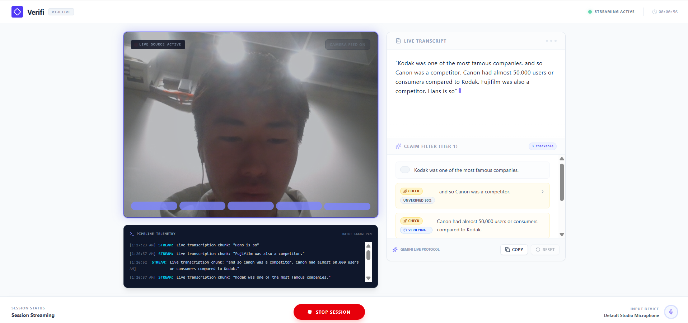

# Verifi


A live diligence assistant for founder pitches. Built for the Stanford x DeepMind hackathon. Verifi listens to a pitch in real time, transcribes it, flags factual claims worth checking, verifies them against the web, and produces an investor-style score when the session ends.



## How it works

1. **Capture** — the browser grabs mic (and optionally camera) audio and streams 16kHz PCM frames over a WebSocket to the server.
2. **Transcription** — the server relays audio to the Gemini Live API (`gemini-3.1-flash-live-preview`), which acts as a silent transcriber and streams text back.
3. **Claim filtering** — each completed sentence is screened in two tiers: cheap regex/keyword heuristics catch obvious claims (numbers, superlatives, traction metrics, competitor mentions); anything ambiguous gets a fast model classification pass (`gemini-3.1-flash-lite`).
4. **Verification** — checkable claims are fact-checked with `gemini-3.5-flash` using Google Search grounding, returning a verdict (supported / contradicted / mixed / unverifiable), a confidence score, reasoning, and cited sources.
5. **Founder Score** — once the session stops, the full transcript plus all claim verdicts are scored across credibility, clarity, traction, and market understanding, with an executive summary, an evidence trail, and suggested follow-up questions.

## Tech stack

- Next.js 15 + React 19, Tailwind CSS 4, Framer Motion, lucide-react
- Custom Express server (`server.ts`) hosting both the Next.js app and a raw WebSocket endpoint (`/api/live-ws`)
- `@google/genai` — Gemini Live API (transcription), Gemini with Google Search grounding (verification), Gemini structured output (classification + scoring)

## Run locally

**Prerequisites:** Node.js

1. Install dependencies:
   ```
   npm install
   ```
2. Copy `.env.example` to `.env` and set `GEMINI_API_KEY` to your Gemini API key.
3. Start the app:
   ```
   npm run dev
   ```
4. Open `http://localhost:3000`, grant microphone (and optionally camera) access, and click **Start Pitch Session**.

## Environment variables

| Variable | Description |
| --- | --- |
| `GEMINI_API_KEY` | Required. Used for Gemini Live transcription, claim verification, classification, and scoring. |
| `GEMINI_API_KEY_PAID` | Optional. If set, takes priority over `GEMINI_API_KEY` — useful for pointing at a paid-tier project instead of a free-tier key. |
| `APP_URL` | The URL the app is hosted at (used for self-referential links). |

## Project structure

```
app/            Next.js app router pages (main UI in app/page.tsx)
server.ts       Custom Express + WebSocket server, Gemini API routes
hooks/          Shared React hooks
lib/            Shared utilities
assets/         Static assets
```
